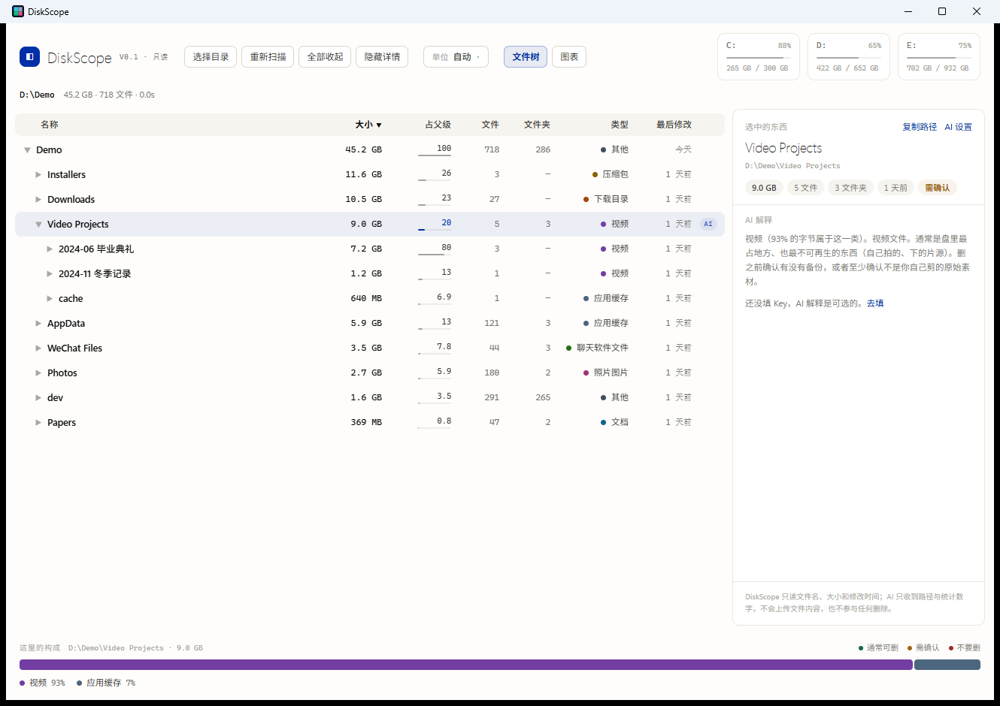
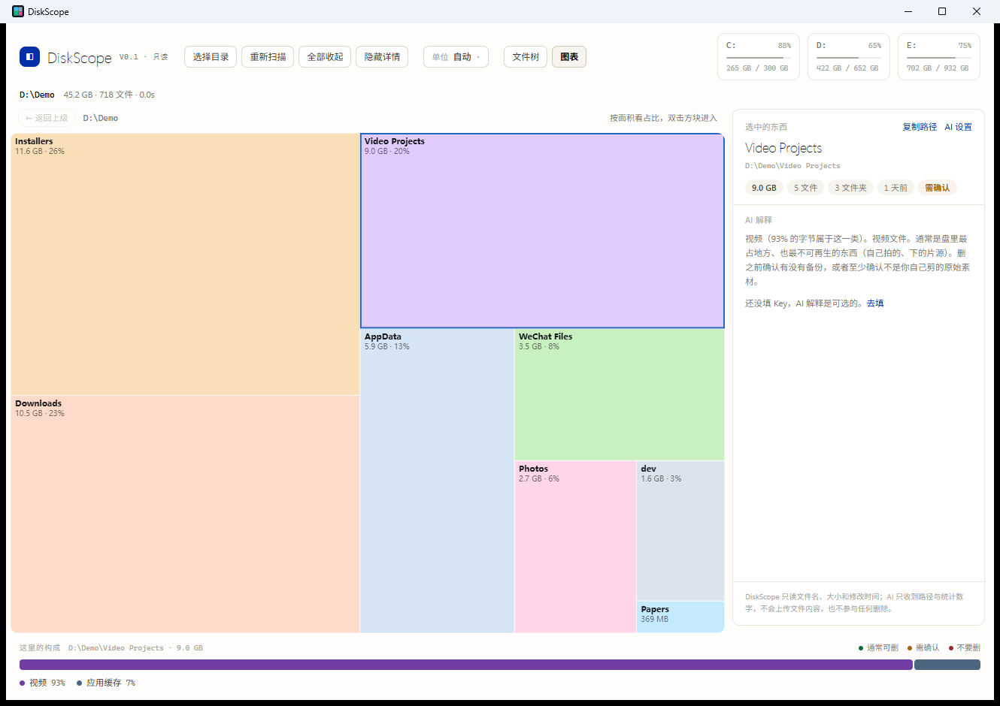

# DiskScope

看清楚地盘被谁吃了，**并且知道为什么** —— 而不只是画个方块图。

> **当前版本 v0.1，只读**：扫描、可视化、分类、解释。**不会删除、移动或修改任何文件。**



<sub>截图扫的是自造的演示目录（718 个文件 / 45.2 GB，全部是稀疏文件，没有任何真实文件内容）；右上角磁盘卡片显示的是截图那台机器的实际容量。</sub>

---

## 为什么要做这个

TreeSize Free / WizTree 会告诉你「这个文件夹有 3.2 GB」，但不会告诉你
「这是微信的聊天缓存，删了不影响聊天记录，但历史图片会打不开」。

大多数人清不动盘，不是因为看不见大小，而是因为**看见了也不敢动**。
DiskScope 想补的就是这一层解释：

- **离线规则库**（`rules/categories.json`，22 类）覆盖常见空间大户：开发依赖、浏览器缓存、
  聊天软件文件、游戏资源、系统文件、临时文件、下载目录、镜像备份……
  每一类给出「这是什么 / 谁生成的 / 删了会怎样」和风险等级。
- **目录级推断**：目录自己没有扩展名，规则匹配不到时，按子项字节占比推断
  （「这个文件夹 83% 是视频」），而不是一律标成「其他」。
- **可选 AI 解释**（BYOK）：规则没覆盖的东西，把**元数据**（路径、大小、修改时间、
  子项名单、本地统计数字）发给 OpenAI 兼容接口，拿回一段人话解释。
  设置里是**服务商下拉**（DeepSeek / 通义千问 / Kimi / 智谱 GLM / 自定义 OpenAI 兼容），
  选中即填好接口地址和候选模型，只需要粘一个 Key。本机地址（Ollama 之类）
  走「自定义」，认得出是 127.0.0.1 时不要求 Key。解释结果显示在右侧详情栏
  下半部分，不弹窗口，方便一边看树一边读。

**AI 永远不参与删除决策，它只负责让用户看懂。** 一个看不到「文件属于谁」的模型，
不该替你决定导师的数据和论文初稿的去留。

---

## 现在做到了什么

### 扫描引擎（Rust）

| 能力 | 说明 |
| --- | --- |
| 多线程遍历 | rayon 并行扫子目录；E 盘 706 GB / 62 万文件 ≈ 3 秒，C 盘 253 GB / 108 万文件 **4–12 秒**（冷热缓存差异） |
| 实时进度 | 每 200 ms 推送一次（文件数 / 已扫字节 / 当前路径），可随时停止 |
| 统计口径向资源管理器看齐 | 硬链接照计（Explorer 也重复计）；**跳过 junction / 符号链接**，避免重复计数与成环 |
| 无权目录不静默 | 拒绝访问的目录单独计数并在界面显示 —— 悄悄少报比报错更糟 |
| 长路径 | 超过 MAX_PATH 自动加 `\\?\` 前缀 |

### 界面

主视图是 **TreeSize 式的文件树表**，方块图作为可切换的第二视图。

**文件树表**

- 列：名称 / 大小 / 占父级 / 文件 / 文件夹 / 类型 / 最后修改，表头可点排序
- 占父级这一列是连续色阶而不是固定几档：占比越大，条越长、越蓝、数字越深，
  几十个 0.1% 的行会自动退成浅灰蓝，一眼看到的是真正的大户
- **虚拟滚动**：只渲染可视的二十几行，百万行也能拖动到底
- 懒加载展开（点三角或双击行名），箭头 / ↑↓ / ←→ / Enter 键盘可用
- 类型列用彩色圆点标分类、徽章标风险档（通常可删 / 需确认 / 不要删）；
  分类是「按目录名猜的」而不是按内容算的时，悬停能看到「按名字猜的」提示
- **零星小文件会自动收成一行**（"27 个小文件"）：同一层里排在末尾、每个都不到父级 0.4%
  的连续文件合成一条，点三角展开逐个看。磁盘上并没有这样一个文件夹，它只是为了让列表
  不被几百行小文件撑长——TreeSize 的做法，这里也一样。合计超过父级 12% 就不收，那种体量
  本身就是要看的东西，不该被藏起来

**磁盘块视图**（工具条右侧切换）

- Squarified treemap，Canvas 绘制，面积严格等于字节占比
- 有自己的下钻路径，双击方块进入、面包屑返回，和文件树互不干扰
- 方块用的是分类色相的白底淡染（目录 15%、文件 9%），不是分类色本身——一墙高饱和色块会把大小关系淹掉
- 22 个分类色的亮度统一在 OKLCH L≈0.5，对比白底 4.6–8.4，所以任意两个标签看起来重量相当



**共用**

- 顶部：磁盘卡片、选择目录、重新扫描、全部展开/收起、单位切换（自动 / GB / MB）
- 右侧可收起的详情栏：**这里的构成**（当前目录各分类的字节与百分比）、
  **选中的东西**（大小、文件数、类别、风险徽章、该类解释）、复制路径、
  AI 解释按钮、清理按钮（v0.1 灰显）

### 分类引擎

- 规则字段：`path_any`（路径子串）、`dir_any`（目录名全等）、`dir_has_any`、
  `name_any` / `name_has_any`（文件名）、`ext_any`（扩展名）、`path_over_ext`（路径优先于扩展名）
- 风险三档：`safe` 通常可删 / `confirm` 需确认 / `never` 不要删
- **inherit**：游戏库、安装目录这类「容器」把归属传给子目录
  （`E:\SteamLibrary\steamapps\common\Space Marine 2` 里那些没有扩展名的 .pak 也算游戏）
- **weak**：`data`（程序数据块）只是「字节是什么」，不说明「谁拥有」；
  遇到游戏/程序这类容器会让位，避免把 40 GB 游戏资源说成「可删的程序数据」
- 规则是纯数据（JSON，编译期 `include_str!` 内嵌），**加规则不用写 Rust**

### 解释与隐私

- AI 配置只存本机 localStorage，默认关闭，不填 Key 不影响任何功能
- 只发送路径、大小、时间、子项名单与统计数字，**不上传文件内容**
- 每条解释固定四段：【这是什么】【谁生成的】【删了会怎样】【建议】

### 工程质量

- `cargo test --lib`：**16 个测试**（统计口径、扩展名归一、规则边界、weak/inherit 优先级、
  混合目录不乱贴标签等回归）
- `tsc --noEmit` + `vite build` 通过；几何算法另有真实尺寸的独立校验（面积/重叠/越界）
- 可打包：`.msi`（1.9 MB）与 `.exe` 安装器（1.3 MB），GitHub Actions 打 tag 自动出 draft release

---

## 还没做 / 计划中

### v0.2 —— 删除（**这部分故意还没做**）

- [ ] 删除到回收站（`SHFileOperation` / `IFileOperation`，可撤销，不直接 `remove`）
- [ ] 删除前的确认面板：把「将释放多少 / 影响哪些程序 / 是否可恢复」摊开说
- [ ] 批量选择与「按分类一键清理候选」（只勾 `safe` 档，`never` 档不给勾）
- [ ] 撤销入口（回收站里的记录回链到本应用）
- 设计上的硬约束：**AI 的「建议」永远不能直接触发删除**，最多是提示词

### v0.3 —— 速度

- [ ] NTFS **MFT 直读**（`FSCTL_ENUM_USN_DATA`），把扫盘压到 1 秒级（现在已是十几秒）
- [ ] MFT 不可用时回退到现在的普通遍历（保留现有语义与测试）
- [ ] 扫描结果缓存 / 增量重扫（只重扫变更目录）

### AI 能力

- [ ] **文件内容分析**：现在只发元数据，还没读文件内容。后续打算支持
  「用户显式点选某个文本/文档，本地抽取片段后再询问」，并且
  **默认本地处理、上传前明确提示上传了什么**
- [ ] 目录级解释的信息量：目前给了路径、大小、子项名单、分类占比，
  对「这个文件夹是哪个软件装的」还可以更准（比如查注册表 / 签名 / 安装清单）
- [x] 本地模型（Ollama 等）：走「自定义」填本机地址即可，不需要 Key，
  数据一步都不出机器
- [ ] 预设之外的服务商仍然要手填地址；模型名靠「检测可用模型」问接口拿，
  没有离线缓存

### 分类规则

- [ ] 规则库目前偏中文 Windows 环境，英文/其他语言系统的常见目录还很少
- [ ] 误判仍存在（实测样本）：
  - `E:\Photoshop`（破解版安装包目录）被判「压缩包」—— 因为里面确实是 .7z/.rar
  - `E:\pydata`（含大量图片 + 几个 .py）被判「照片图片 96.8%」—— 按字节占比是诚实的，但用途是代码项目
  - 各种「新建文件夹」仍然落到「其他」
  - 反过来的情况：`D:\Installers`（专门装安装包的目录）被判成「压缩包」，
    因为里面清一色是 .iso / .zip / .rar。按字节推断本身没错，但它回答的是「里面装的是什么」，
    而不是「这个目录是拿来干什么的」
- [ ] 需要一套可回归的「真实目录 → 期望分类」样本集，避免每次改规则都靠肉眼

### 其他

- [ ] 只有 Windows（Tauri 本身跨平台，但扫描语义与长路径处理是 Windows 专属）
- [ ] 界面只有中文
- [ ] 没有搜索 / 过滤（大目录里想直接找一个名字）
- [ ] 没有导出报告（CSV / 截图）
- [ ] 没有重复文件查找（同尺寸 + 哈希）
- [ ] 安装包未签名，Windows SmartScreen 会提示；也没做自动更新
- [ ] 目录树常驻内存，扫 C 盘约占数百 MB（后续可改成懒加载）

---

## 开发

```bash
# 需要 Rust (MSVC toolchain) + Node 18+ + VS Build Tools（含 C++ 桌面开发）
npm install
npm run tauri dev      # 开发模式
npm run tauri build    # 打包 msi / nsis

cargo test --manifest-path src-tauri/Cargo.toml   # 16 个测试
```

排查分类问题时可以不打界面，直接看 Rust 侧的判定：

```bash
cd src-tauri
cargo run --example diag -- "E:\" 1        # 扫 E 盘根，列出每个子项的 category / share
cargo run --example diag -- "E:\SteamLibrary" 2
```

### 代码结构

```
src-tauri/src/
  scan.rs        扫描、Node 树、finalize（汇总 + 分类 + 排序 + 文件/文件夹计数）
  categories.rs  规则加载与匹配、Composition（字节占比）、compose()
  lib.rs         Tauri command：scan / get_rows / category_totals / explain_with_ai …
rules/categories.json   22 类规则（纯数据，可直接 PR）
src/
  App.tsx        布局、状态、三段式侧栏、视图切换、AI 设置弹窗
  TreeTable.tsx  虚拟滚动树表（主视图）
  Treemap.tsx    Canvas treemap 绘制 + 点击/悬停 + 墨色计算
  squarify.ts    squarified treemap 算法（纯函数，可单测）
```

### 补一条分类规则

见 [CONTRIBUTING.md](CONTRIBUTING.md)：改 `rules/categories.json` 即可，不需要写 Rust。

---

## License

MIT
